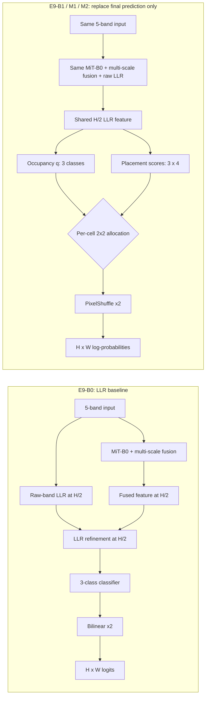

# Exp09 — LLR + Occupancy-Conditioned 2×2 Sub-Cell Head

## Mục tiêu và claim gate

Bản Word cũ báo cáo `85.49 ± 0.30%` mIoU trên **test lịch sử** cho SegFormer MiT-B0 5-band + LLR. Exp00–07 có kết quả của L0, D½-none, LiteSent, PS, MCSD-g và OccCond-g, nhưng chưa chứng minh head sub-cell cải thiện mIoU so với chính LLR. Exp09 trả lời câu hỏi đó bằng so sánh trên **cùng validation split, 5 seed, cùng training protocol**.

**Không so validation mới với 85.49% test để kết luận thắng/thua.** E9-B0 là đối chứng chính; mốc cũ chỉ được trích dẫn như kết quả test của model Word cũ với lịch sử/provenance riêng. Nếu không khôi phục được validation/checkpoint LLR tương thích thì train lại E9-B0 trước khi kết luận, không thay bằng test number.

Kết quả Exp09 thuộc validation và có tính exploratory vì dùng validation để chọn checkpoint theo mIoU. Không mở test. PASS dưới đây chỉ có nghĩa đạt tiêu chí so sánh đã khóa trong validation, không phải xác nhận độc lập/held-out.

## Vì sao dùng 2×2

Exp05–07 dự đoán decoder feature H/4 thành 4×4 sub-cells, phù hợp với L0 vốn dự đoán ở H/4. LLR đã tạo feature ở H/2. Exp09 giữ nguyên backbone, multi-scale fusion và LLR raw five-band, rồi thay classifier cuối + bilinear ×2 bằng bốn xác suất lớp con cho mỗi vị trí H/2. Mỗi ô H/2 tương ứng đúng 2×2 pixel đầu ra; không thêm decoder H/2 mới.



The E9 heads are implemented in `src/nets/llr_subcell.py` and train/eval integration is registered through `src/train.py` and `src/ccmc_common.py`. Existing bilinear and H/4 heads remain separate code paths.

## Locked model matrix

| ID    | Architecture                                                                                                       | Difference from E9-B0                                                                                           | Role                                                                                                                                               |
| ----- | ------------------------------------------------------------------------------------------------------------------ | --------------------------------------------------------------------------------------------------------------- | -------------------------------------------------------------------------------------------------------------------------------------------------- |
| E9-B0 | 5-band MiT-B0 + multi-scale fusion + raw LLR H/2 + classifier + bilinear ×2                                        | Reference                                                                                                       | In the completed Exp09 evidence, P0 selected `TRAIN_E9B0`: LiteSent reuse was rejected because the historical LLR source was not fully compatible. |
| E9-B1 | Same LLR feature + occupancy head + placement head + PixelShuffle 2×2                                              | Replaces final classifier/upsampler; occupancy auxiliary loss enabled, but q is not used to condition placement | Controls gains due to a sub-cell head alone.                                                                                                       |
| E9-M1 | Same heads, same initialization recipe, same occupancy loss as B1; `log_softmax(log(q) + scores/tau)` per sub-cell | Uses q to condition each 2×2 sub-cell; no Sinkhorn                                                              | Tests occupancy conditioning beyond simply adding a sub-cell head.                                                                                 |
| E9-M2 | Same heads, initialization, guide/loss and 2×2 grid; finite Sinkhorn allocation                                    | Uses q as approximate row marginal                                                                              | Tests the extra marginal constraint; secondary/exploratory.                                                                                        |

For all variants: five bands `R,G,B,NIR,RE`, same split hash `675667edf3f35f16`, seeds 0–4, 100 epochs, batch 8, Adam lr `3e-4`, class weights `[0.9,1.0,1.3]`, weighted CE + Soft Dice (`0.3`), same augmentation, same checkpoint selection by validation mIoU. Set `spectral_guide=False`: the LLR already consumes raw 5-band input, and a second guide would confound attribution. E9-M2 uses `sinkhorn_iters=5`, `tau=1.0`; B1/M1/M2 use `occ_weight=0.3`.

The three sub-cell heads are initialized from the same LLR/base initialization for each seed. The new occupancy and placement layers are initialized after the inherited LLR model; placement starts at zero as in the existing MCSD design. No E9 variant loads a validation-selected trained LLR checkpoint as a warm start. B0 may reuse a complete existing **evaluation result/checkpoint** only if P0 passes; otherwise all four models train under the E9 run protocol.

## Registered endpoints and decision rule

Primary endpoint: validation mIoU, paired across seed and image. Two predeclared hypotheses:

- H1: E9-M1 − E9-B0 mIoU is positive, with paired 95% CI lower bound `> 0`.
- H2: E9-M1 − E9-B1 mIoU is positive, with paired 95% CI lower bound `> 0`.
- Crop-IoU guard for each primary contrast: 95% CI lower bound `> -1.0 pp`.

Decision: `PASS` only when the mIoU CI lower bound is above zero and Crop-IoU guard passes. `FAIL` if mIoU CI upper bound is at or below zero, or Crop-IoU CI upper bound is at or below `-1 pp`. Otherwise report `INCONCLUSIVE`. Report point estimate and 95% CI regardless. E9-M2 is secondary: compare against B0 and M1, report results without selecting a winner post hoc.

Secondary metrics: Weed IoU, Crop IoU, Weed BIoU (3 px), Small-Weed Recall@IoU 0.5, `cov_small`, parameters, counted GFLOPs, synchronized latency, and peak VRAM. `cov_small` is not instance recall; pixel Weed precision is not false-positive instance count. Bootstrap is hierarchical paired seed + image, 10,000 draws, fixed RNG seed 0. Mark the analysis `EXPLORATORY_VALIDATION`; no independent test claim.

## Kaggle prerequisites

1. Commit and push the source changes (`src/nets/llr_subcell.py`, training/evaluation integration, `tests/test_llr_subcell.py`, this runbook); use a fresh Kaggle notebook cloned from that commit. Do not use a destructive `rm -rf` clone cell over an existing workspace containing valuable artifacts.
2. Attach WeedsGalore dataset, the existing Exp06 results and checkpoint datasets (including all LiteSent seeds if considering reuse), plus the existing frozen backbone/download access needed for `nvidia/mit-b0`. Enable Internet if pretrained weights are not cached.
3. Keep all new outputs under `results/exp09/`; never write under or modify `results/exp08/`. Do not run any test split or Cell D.
4. Expected packages on Kaggle: PyTorch, `transformers==4.45.2`, `torchmetrics`, `absl-py`, `pytest`, NumPy, OpenCV, and Matplotlib. Do not change the active Torch/CUDA stack just to match the old Word draft.

Run cells in order in one notebook/kernel. P0/P1 must pass before training. In the completed evidence, P0 set `baseline_action=TRAIN_E9B0`: only 2/5 LiteSent records matched the historical LLR source, so reuse was rejected and E9-B0 was trained under the locked protocol. The conditional reuse branch remains in the cell only as an audit rule for a future run; it must not be used to reinterpret the completed Exp09 evidence.

## E9-00 — Session, paths, and isolated output

```python
from datetime import datetime, timezone
from pathlib import Path
import glob
import os

PROJECT = Path('/kaggle/working/WeedsGalore_Ipr28')
assert PROJECT.is_dir(), PROJECT
os.chdir(PROJECT)

RUN_ID = datetime.now(timezone.utc).strftime('%Y%m%dT%H%M%SZ')
OUT = PROJECT / 'results' / 'exp09' / RUN_ID
OUT.mkdir(parents=True, exist_ok=False)
(OUT / 'logs').mkdir()
(OUT / 'runs').mkdir()

if 'DS' not in globals():
    candidates = sorted(glob.glob('/kaggle/input/**/2023-05-25/semantics', recursive=True))
    assert candidates, 'Attach WeedsGalore as a Kaggle Input before E9-P2/P3.'
    DS = str(Path(candidates[0]).parent.parent)
assert Path(DS).is_dir(), DS

BINS = PROJECT / 'results' / 'instance_bins.json'
assert BINS.is_file(), f'Locked instance bins not found: {BINS}'
print('Project:', PROJECT)
print('Dataset root:', DS)
print('Exp09 output:', OUT)
print('Split hash expected: 675667edf3f35f16')
print('No test or Exp08 path is used by this runbook.')
```

## E9-P0 — Restore/verify the LLR validation baseline

This is a no-inference audit, except strict state-dict loading into the current LLR architecture. It reads config/summary/per-image validation artifacts and checkpoint weights, not images or labels. It does not evaluate a checkpoint. `REUSE_LITESENT_VALIDATION` requires all five seeds to have matched config flags, split, 26-image validation summary, per-image CSV, checkpoint file/hash, parameter count, historical LLR implementation signature and strict checkpoint load. Any failure means retrain E9-B0; do not compare against the old Word test number.

```python
import ast
import hashlib
import json
import subprocess
import torch
from pathlib import Path

from nets.segformer import SegFormer5Band
from ccmc_common import load_checkpoint

EXP06 = PROJECT / 'doc' / 'exp06_results' / 'results' / 'exp06'
if not EXP06.is_dir():
    hits = sorted(Path('/kaggle/input').glob('**/exp06_results/results/exp06'))
    EXP06 = next((path for path in hits if path.is_dir()), None)
assert EXP06 is not None and Path(EXP06).is_dir(), 'Attach/restore Exp06 result artifacts.'

def sha256_file(path):
    digest = hashlib.sha256()
    with Path(path).open('rb') as stream:
        for chunk in iter(lambda: stream.read(1024 * 1024), b''):
            digest.update(chunk)
    return digest.hexdigest()

def class_signatures(source_text):
    tree = ast.parse(source_text)
    wanted = {'PretrainedMiTEncoder', 'LowLevelRefine', 'SegFormer5Band'}
    return {
        node.name: ast.dump(node, include_attributes=False)
        for node in tree.body if isinstance(node, ast.ClassDef) and node.name in wanted
    }

current_source = (PROJECT / 'src' / 'nets' / 'segformer.py').read_text(encoding='utf-8')
current_signatures = class_signatures(current_source)
assert set(current_signatures) == {'PretrainedMiTEncoder', 'LowLevelRefine', 'SegFormer5Band'}

def locate_config(seed):
    run = f'LiteSent_s{seed}'
    candidates = list((PROJECT / 'doc').glob(f'exp*_results/results/exp*/runs_meta/{run}/run_config.json'))
    input_root = Path('/kaggle/input')
    if input_root.is_dir():
        candidates.extend(input_root.glob(f'**/runs_meta/{run}/run_config.json'))
    return sorted(path for path in candidates if path.is_file())

def locate_checkpoint(seed):
    run = f'LiteSent_s{seed}'
    roots = [PROJECT / 'runs']
    input_root = Path('/kaggle/input')
    if input_root.is_dir():
        roots.extend(path for path in input_root.glob('**/runs') if path.is_dir())
    return next((root / run / 'best_val.pth' for root in roots
                 if (root / run / 'best_val.pth').is_file()), None)

expected_common = {
    'dataset_size_train': 104, 'in_channels': 5, 'num_classes': 3,
    'use_multiscale_fusion': True, 'use_low_level_refine': True,
    'segformer': True, 'ccmc': False, 'spectral_guided': False,
    'batch_size': 8, 'lr': 0.0003,
    'weight_bg': 0.9, 'weight_crop': 1.0, 'weight_weed': 1.3,
    'use_dice_loss': True, 'dice_weight': 0.3, 'epochs': 100,
}
records = {}
strict_load_ok = True
baseline_model = None
device = torch.device('cpu')

for seed in range(5):
    run = f'LiteSent_s{seed}'
    errors = []
    configs = locate_config(seed)
    config_path = configs[0] if len(configs) == 1 else None
    if config_path is None:
        errors.append(f'expected one run_config, found {len(configs)}')
        config = {}
        flags = {}
    else:
        config = json.loads(config_path.read_text(encoding='utf-8'))
        flags = config.get('flags', {})
        if config.get('split_hash') != '675667edf3f35f16':
            errors.append('split hash mismatch')
        if config.get('run_name') not in (f'LiteSent__s{seed}', run):
            errors.append('run name mismatch')
        for key, value in expected_common.items():
            if flags.get(key) != value:
                errors.append(f'{key} mismatch: {flags.get(key)!r} != {value!r}')
        if flags.get('llr_source', 'raw') != 'raw':
            errors.append('LLR source is not raw')
        if config.get('num_params') != 3662291:
            errors.append(f'parameter signature mismatch: {config.get("num_params")}')

    summary_path = EXP06 / f'{run}_val_summary.json'
    csv_path = EXP06 / f'{run}_val_per_image.csv'
    summary = json.loads(summary_path.read_text(encoding='utf-8')) if summary_path.is_file() else {}
    if summary.get('run_name') != run or summary.get('split') != 'val' or summary.get('n_images') != 26:
        errors.append('validation summary missing or has wrong run/split/image count')
    if summary.get('head') != 'bilinear' or summary.get('GT_LEAKAGE') is not False:
        errors.append('summary is not a non-oracle bilinear LLR evaluation')
    if not csv_path.is_file():
        errors.append('per-image validation CSV missing')
    else:
        import csv as csv_module
        with csv_path.open(newline='', encoding='utf-8') as stream:
            rows = list(csv_module.DictReader(stream))
        if len(rows) != 26 or len({row['name'] for row in rows}) != 26:
            errors.append('validation CSV does not contain 26 unique images')

    checkpoint_path = locate_checkpoint(seed)
    checkpoint_hash = sha256_file(checkpoint_path) if checkpoint_path else None
    if checkpoint_path is None:
        errors.append('best_val checkpoint not found under Kaggle Inputs/project runs')
    else:
        try:
            if baseline_model is None:
                baseline_model = SegFormer5Band(
                    num_classes=3, decoder_dim=128, pretrained_backbone=True,
                    in_channels=5, use_low_level_refine=True,
                    use_multiscale_fusion=True, llr_source='raw',
                ).cpu()
            load_checkpoint(baseline_model, checkpoint_path, device)
        except Exception as error:
            strict_load_ok = False
            errors.append(f'strict checkpoint load failed: {error!r}')

    commit = config.get('env', {}).get('git_commit')
    source_match = False
    source_error = None
    if commit:
        historical = subprocess.run(
            ['git', 'show', f'{commit}:src/nets/segformer.py'], cwd=PROJECT,
            stdout=subprocess.PIPE, stderr=subprocess.PIPE, text=True,
        )
        if historical.returncode == 0:
            source_match = class_signatures(historical.stdout) == current_signatures
        else:
            source_error = historical.stderr.strip() or 'historical source commit unavailable'
    if not source_match:
        errors.append(source_error or 'LLR class implementations differ from training commit')

    records[run] = {
        'status': 'PASS' if not errors else 'FAIL',
        'errors': errors,
        'config_path': str(config_path) if config_path else None,
        'config_sha256': sha256_file(config_path) if config_path else None,
        'training_commit': commit,
        'llr_source': flags.get('llr_source', 'raw (legacy default)'),
        'source_ast_matches_training_commit': source_match,
        'validation_summary': str(summary_path) if summary_path.is_file() else None,
        'validation_csv': str(csv_path) if csv_path.is_file() else None,
        'checkpoint_path': str(checkpoint_path) if checkpoint_path else None,
        'checkpoint_sha256': checkpoint_hash,
    }

reuse = strict_load_ok and all(record['status'] == 'PASS' for record in records.values())
report = {
    'status': 'REUSE_LITESENT_VALIDATION' if reuse else 'TRAIN_E9B0',
    'historical_word_test_miou': 85.49,
    'historical_word_test_is_e9_threshold': False,
    'reuse_gate': 'all 5 seeds: config/split/protocol, matching LLR source AST, validation summary/CSV, and strict checkpoint load',
    'run_records': records,
    'current_segformer_source_sha256': sha256_file(PROJECT / 'src' / 'nets' / 'segformer.py'),
    'strict_checkpoint_load_all': strict_load_ok,
    'note': 'This is a metadata/checkpoint compatibility audit. It does not run inference or read validation/test images or labels.',
}
(OUT / 'e9_p0_llr_baseline_audit.json').write_text(json.dumps(report, indent=2), encoding='utf-8')
print('Saved:', OUT / 'e9_p0_llr_baseline_audit.json')
print('Baseline action:', report['status'])
print('P0 matched seeds:', sum(record['status'] == 'PASS' for record in records.values()), '/ 5')
```

### E9-P1 — Synthetic correctness gate

Run only the synthetic unit tests. Do not start training unless this cell prints `E9-P1 PASS`.

```python
import subprocess
import sys

log_path = OUT / 'logs' / 'e9_p1_tests.log'
with log_path.open('w', encoding='utf-8') as log:
    result = subprocess.run(
        [sys.executable, '-m', 'pytest', '-q', 'tests/test_llr_subcell.py'],
        cwd=PROJECT, stdout=log, stderr=subprocess.STDOUT, text=True,
    )
test_output = log_path.read_text(encoding='utf-8')
print(test_output)
test_report = {
    'status': 'PASS' if result.returncode == 0 else 'FAIL',
    'exit_code': result.returncode,
    'command': 'pytest -q tests/test_llr_subcell.py',
    'log': str(log_path.relative_to(PROJECT)),
    'output': test_output,
    'test_data_accessed': False,
}
(OUT / 'e9_p1_test_summary.json').write_text(json.dumps(test_report, indent=2), encoding='utf-8')
assert result.returncode == 0, 'E9-P1 failed; stop before any training.'
print('E9-P1 PASS')
```

### E9-P2 — Train B0 if needed, then B1/M1/M2, seeds 0–4

If P0 says `REUSE_LITESENT_VALIDATION`, B0 is not retrained; its existing five validation CSVs/checkpoints are retained as the matched reference. If P0 says `TRAIN_E9B0`, E9-B0 is trained here. Train all sub-cell variants with the same seed protocol. A resumed partial run uses its own `last.pth`; do not reuse another model's optimizer/training state.

```python
import json
import subprocess
import sys

p0 = json.loads((OUT / 'e9_p0_llr_baseline_audit.json').read_text(encoding='utf-8'))
p1_path = OUT / 'e9_p1_test_summary.json'
assert p1_path.is_file(), 'Run E9-P1 before training.'
p1 = json.loads(p1_path.read_text(encoding='utf-8'))
assert p1.get('status') == 'PASS', 'E9-P1 did not pass; stop before training.'
baseline_reusable = p0['status'] == 'REUSE_LITESENT_VALIDATION'
common = [
    f'--dataset_path={DS}', '--dataset_size_train=104', '--in_channels=5', '--num_classes=3',
    '--batch_size=8', '--num_workers=4', '--lr=0.0003',
    '--weight_bg=0.9', '--weight_crop=1.0', '--weight_weed=1.3',
    '--use_dice_loss=True', '--dice_weight=0.3', '--epochs=100',
    '--log_interval=50', '--ckpt_interval=1000000', '--pretrained_backbone=True',
    '--use_multiscale_fusion=True', '--spectral_guided=False', '--spectral_guide=False',
    '--measure_stats=False', '--resume=True',
]
architectures = {
    'E9B0': ['--head=bilinear', '--ccmc=False', '--segformer=True',
             '--use_low_level_refine=True', '--llr_source=raw'],
    'E9B1': ['--head=pixelshuffle2', '--ccmc=False', '--segformer=True',
             '--use_low_level_refine=True', '--llr_source=raw', '--occ_weight=0.3'],
    'E9M1': ['--head=occ_conditioned2', '--ccmc=False', '--segformer=True',
             '--use_low_level_refine=True', '--llr_source=raw', '--occ_weight=0.3',
             '--mcsd_tau=1.0'],
    'E9M2': ['--head=mcsd2', '--ccmc=False', '--segformer=True',
             '--use_low_level_refine=True', '--llr_source=raw', '--occ_weight=0.3',
             '--sinkhorn_iters=5', '--mcsd_tau=1.0'],
}

train_order = [(model, seed) for seed in range(5)
               for model in ('E9B0', 'E9B1', 'E9M1', 'E9M2')]
if baseline_reusable:
    train_order = [(model, seed) for model, seed in train_order if model != 'E9B0']

for model, seed in train_order:
    run = f'{model}_s{seed}'
    run_dir = OUT / 'runs' / run
    summary = run_dir / 'run_summary.json'
    if summary.is_file():
        print('Already complete:', run)
        continue
    log_path = OUT / 'logs' / f'train_{run}.log'
    command = [
        sys.executable, 'src/train.py', *common, *architectures[model],
        f'--seed={seed}', f'--run_name={run}', f'--out_dir={run_dir}',
    ]
    print('Training:', run)
    with log_path.open('w', encoding='utf-8') as log:
        result = subprocess.run(command, cwd=PROJECT, stdout=log,
                                stderr=subprocess.STDOUT, text=True)
    if result.returncode != 0:
        print(log_path.read_text(encoding='utf-8')[-4000:])
        raise RuntimeError(f'{run} failed; preserve log and do not proceed to analysis.')
    assert summary.is_file(), f'No completed run_summary for {run}'
print('Training stage completed. Baseline reused:', baseline_reusable)
```

### E9-P3 — Validation evaluation and paired analysis

All E9 predictions are validation-only. The reused baseline, if authorized by P0, is copied byte-for-byte into the E9 evidence folder as a clearly labeled reference; its original summary retains the original LiteSent run name. No test split is accepted by these cells.

```python
import csv
import json
import shutil
import subprocess
import sys

p0 = json.loads((OUT / 'e9_p0_llr_baseline_audit.json').read_text(encoding='utf-8'))
p0_reuse = p0['status'] == 'REUSE_LITESENT_VALIDATION'
run_files = {}

def existing_validation_pair(prefix):
    per_image = Path(str(prefix) + '_per_image.csv')
    summary = Path(str(prefix) + '_summary.json')
    if per_image.is_file() != summary.is_file():
        raise RuntimeError(f'Partial validation artifacts; inspect manually: {prefix}')
    if per_image.is_file():
        return {'per_image.csv': per_image, 'summary.json': summary}
    return None

for seed in range(5):
    run_files[f'E9B0_s{seed}'] = {}
    if p0_reuse:
        source_root = EXP06
        source_run = f'LiteSent_s{seed}'
        for suffix in ('per_image.csv', 'summary.json'):
            source = source_root / f'{source_run}_val_{suffix}'
            target = OUT / 'validation' / f'E9B0_s{seed}_val_{suffix}'
            target.parent.mkdir(parents=True, exist_ok=True)
            if target.is_file():
                assert target.stat().st_size == source.stat().st_size, (
                    f'Existing baseline copy differs in size; inspect manually: {target}'
                )
            else:
                shutil.copy2(source, target)
            run_files[f'E9B0_s{seed}'][suffix] = target
    else:
        run = f'E9B0_s{seed}'
        run_dir = OUT / 'runs' / run
        ckpt = run_dir / 'best_val.pth'
        assert ckpt.is_file(), f'B0 checkpoint missing: {ckpt}'
        prefix = OUT / 'validation' / f'{run}_val'
        existing = existing_validation_pair(prefix)
        if existing is None:
            command = [
                sys.executable, 'src/evaluate_ccmc.py', f'--dataset_path={DS}', '--split=val',
                f'--ckpt={ckpt}', '--ccmc=False',
                '--use_low_level_refine=True', '--llr_source=raw', '--head=bilinear',
                f'--bins_json={BINS}', '--boundary_px=3', f'--run_name={run}',
                f'--out_prefix={prefix}',
            ]
            subprocess.run(command, cwd=PROJECT, check=True)
            existing = existing_validation_pair(prefix)
            assert existing is not None, f'B0 evaluation did not create both artifacts: {prefix}'
        run_files[run] = existing

eval_arch = {
    'E9B1': ['--head=pixelshuffle2'],
    'E9M1': ['--head=occ_conditioned2', '--mcsd_tau=1.0'],
    'E9M2': ['--head=mcsd2', '--sinkhorn_iters=5', '--mcsd_tau=1.0'],
}
for model, arch_flags in eval_arch.items():
    for seed in range(5):
        run = f'{model}_s{seed}'
        ckpt = OUT / 'runs' / run / 'best_val.pth'
        assert ckpt.is_file(), f'Checkpoint missing: {ckpt}'
        prefix = OUT / 'validation' / f'{run}_val'
        existing = existing_validation_pair(prefix)
        if existing is None:
            command = [
                sys.executable, 'src/evaluate_ccmc.py', f'--dataset_path={DS}', '--split=val',
                f'--ckpt={ckpt}', '--ccmc=False',
                '--use_low_level_refine=True', '--llr_source=raw', *arch_flags,
                '--spectral_guide=False',
                f'--bins_json={BINS}', '--boundary_px=3', f'--run_name={run}',
                f'--out_prefix={prefix}',
            ]
            subprocess.run(command, cwd=PROJECT, check=True)
            existing = existing_validation_pair(prefix)
            assert existing is not None, f'Evaluation did not create both artifacts: {prefix}'
        run_files[run] = existing

contrasts = [('E9M1', 'E9B0'), ('E9M1', 'E9B1'),
             ('E9M2', 'E9B0'), ('E9M2', 'E9M1'), ('E9B1', 'E9B0')]
comparison_records = {}
for method_a, method_b in contrasts:
    files_a = [run_files[f'{method_a}_s{seed}']['per_image.csv'] for seed in range(5)]
    files_b = [run_files[f'{method_b}_s{seed}']['per_image.csv'] for seed in range(5)]
    name = f'{method_a}_vs_{method_b}'
    output = OUT / f'cmp_{name}.json'
    log = OUT / 'logs' / f'cmp_{name}.log'
    command = [
        sys.executable, 'src/scripts/compare_runs.py',
        f"--a={','.join(str(path) for path in files_a)}",
        f"--b={','.join(str(path) for path in files_b)}",
        f'--name_a={method_a}', f'--name_b={method_b}',
        '--cluster=image', '--seed_bootstrap=True', '--n_boot=10000', '--seed=0',
        '--gate=none',
        '--metrics=SmallWeedRecall,cov_small,mIoU,IoU_weed,IoU_crop,BIoU_weed,PrecisionWeed',
        f'--out={output}',
    ]
    with log.open('w', encoding='utf-8') as stream:
        subprocess.run(command, cwd=PROJECT, stdout=stream, stderr=subprocess.STDOUT,
                       check=True, text=True)
    comparison_records[name] = json.loads(output.read_text(encoding='utf-8'))

def decision(comparison):
    metrics = comparison['metrics']
    miou = metrics['mIoU']
    crop = metrics['IoU_crop']
    if miou['ci95'][0] > 0 and crop['ci95'][0] > -1.0:
        return 'PASS'
    if miou['ci95'][1] <= 0 or crop['ci95'][1] <= -1.0:
        return 'FAIL'
    return 'INCONCLUSIVE'

primary = {
    'H1_E9M1_vs_E9B0': decision(comparison_records['E9M1_vs_E9B0']),
    'H2_E9M1_vs_E9B1': decision(comparison_records['E9M1_vs_E9B1']),
    'rule': 'mIoU delta CI95 lower > 0 and Crop IoU delta CI95 lower > -1.0 pp',
    'interpretation_scope': 'exploratory paired validation; not held-out confirmation',
}
result = {
    'evaluation_split': 'val',
    'p0_baseline_reused': p0_reuse,
    'p0_baseline_status': p0['status'],
    'contrasts': comparison_records,
    'primary_decisions': primary,
    'test_accessed': False,
    'inference_split_test_run': False,
}
(OUT / 'e9_p3_validation_analysis.json').write_text(json.dumps(result, indent=2), encoding='utf-8')
print('Saved:', OUT / 'e9_p3_validation_analysis.json')
print('H1:', primary['H1_E9M1_vs_E9B0'], '| H2:', primary['H2_E9M1_vs_E9B1'])
```

### E9-P4 — Matched compute profile

Profile all four architectures on the same Kaggle T4, FP32, batch 1, 600×600, 50 warmups and 300 timed runs. This profiles initialized architecture instances; it does not use or access test data. Report P0 baseline reuse and the profiler metadata alongside the table.

```python
import json
import subprocess
import sys

profiles = {
    'E9B0': ['--head=bilinear'],
    'E9B1': ['--head=pixelshuffle2'],
    'E9M1': ['--head=occ_conditioned2', '--mcsd_tau=1.0'],
    'E9M2': ['--head=mcsd2', '--sinkhorn_iters=5', '--mcsd_tau=1.0'],
}
records = {}
for label, head_flags in profiles.items():
    output = OUT / f'profile_{label}.json'
    assert not output.exists(), f'Profile already exists; do not overwrite: {output}'
    command = [
        sys.executable, 'src/scripts/profile_model.py', '--ccmc=False',
        '--in_channels=5', '--num_classes=3', '--use_low_level_refine=True',
        '--llr_source=raw', '--use_multiscale_fusion=True', '--spectral_guide=False',
        *head_flags, '--size=600', '--warmup=50', '--runs=300',
        f'--label={label}', f'--out={output}',
    ]
    log = OUT / 'logs' / f'profile_{label}.log'
    with log.open('w', encoding='utf-8') as stream:
        subprocess.run(command, cwd=PROJECT, stdout=stream, stderr=subprocess.STDOUT,
                       check=True, text=True)
    records[label] = json.loads(output.read_text(encoding='utf-8'))

groups = {(tuple(item['input']), item['device'], item['precision'], item['batch'])
          for item in records.values()}
assert len(groups) == 1, f'Profile settings differ: {groups}'
(OUT / 'e9_p4_compute_summary.json').write_text(
    json.dumps({'status': 'PASS_MATCHED_PROFILE', 'profiles': records,
                'test_accessed': False, 'note': 'FlopCounter may omit elementwise Sinkhorn work.'}, indent=2),
    encoding='utf-8',
)
print('Saved:', OUT / 'e9_p4_compute_summary.json')
```

### E9-P5 — Package evidence

```python
from zipfile import ZIP_DEFLATED, ZipFile
import json

audit = json.loads((OUT / 'e9_p0_llr_baseline_audit.json').read_text(encoding='utf-8'))
tests = json.loads((OUT / 'e9_p1_test_summary.json').read_text(encoding='utf-8'))
analysis_path = OUT / 'e9_p3_validation_analysis.json'
compute_path = OUT / 'e9_p4_compute_summary.json'
assert tests['status'] == 'PASS'
assert analysis_path.is_file() and compute_path.is_file()

handoff = {
    'run_id': RUN_ID,
    'baseline_action': audit['status'],
    'p1_tests': tests['status'],
    'evaluation_split': 'validation only',
    'test_accessed': False,
    'historical_word_test_miou': 85.49,
    'historical_word_test_used_as_e9_threshold': False,
    'e9_decision_source': str(analysis_path),
    'compute_source': str(compute_path),
    'claim_boundary': [
        'Compare E9 M1/B1/M2 with E9-B0 on the same validation split and paired seeds.',
        'Do not compare validation mIoU directly against 85.49% historical test mIoU.',
        'No held-out or external-domain result is produced by E9.',
    ],
}
(OUT / 'e9_handoff.json').write_text(json.dumps(handoff, indent=2), encoding='utf-8')
archive = Path('/kaggle/working') / f'exp09_{RUN_ID}_evidence.zip'
with ZipFile(archive, 'w', compression=ZIP_DEFLATED) as zf:
    for path in sorted(OUT.rglob('*')):
        if path.is_file():
            zf.write(path, arcname=str(path.relative_to(PROJECT)))
print(json.dumps(handoff, indent=2))
print('Evidence archive:', archive)
```

## Gửi lại để review

Gửi `exp09_<run-id>_evidence.zip`, `e9_p0_llr_baseline_audit.json`, `e9_p3_validation_analysis.json`, `e9_p4_compute_summary.json`, logs lỗi (nếu có), cùng trạng thái từng run. Nếu P0 chọn `TRAIN_E9B0`, không bỏ B0 dù quota thiếu; đánh dấu `PARTIAL` và không kết luận M1 thắng baseline. Không mở test/Exp08.

## Nhận xét kết quả Exp09 và quyết định chuyển sang Exp10

### Trạng thái evidence

Artifact `exp09_20261106T064320Z_evidence` xác nhận các điều kiện kiểm tra của Exp09 đã đạt: P0 đặt `TRAIN_E9B0` vì chỉ 2/5 LiteSent records khớp source LLR lịch sử, nên không được tái sử dụng LiteSent làm baseline. P1 có `10 passed`, phân tích P3 dùng validation-only với 5 seed, 26 ảnh và bootstrap phân tầng theo ảnh, còn P4 dùng cùng điều kiện profile cho các kiến trúc. `test_accessed=false` và `inference_split_test_run=false`, do đó kết quả này không phải kết quả held-out test.

| Mô hình                           |          mIoU | Diễn giải                                                     |
| --------------------------------- | ------------: | ------------------------------------------------------------- |
| SegFormer 5-band + LLR (bản Word) | 85,49 ± 0,30% | Kết quả test lịch sử, baseline chính của bài ứng dụng         |
| E9-B0 — LLR tái lập               |       84,406% | Validation, 5 seed; đối chứng thực nghiệm của Exp09           |
| E9-B1 — LLR + PixelShuffle        |       83,924% | Validation, 5 seed; thấp hơn B0 `-0,482 pp`                   |
| E9-M1 — LLR + OccCond             |       84,519% | Validation, 5 seed; hơn B0 `+0,113 pp`                        |
| E9-M2 — LLR + Sinkhorn            |       84,329% | Validation, 5 seed; thấp hơn M1 `-0,190 pp` và B0 `-0,077 pp` |
| Mục tiêu phiên bản cải tiến       |       >86,00% | Chưa đạt và chưa được xác minh trên test                      |

### Diễn giải thống kê

M1 hơn B0 về điểm trung bình `0,113 pp`, nhưng CI95% của chênh lệch là `[-0,084; +0,317] pp`. Vì vậy H1 (`M1 - B0 > 0`) là `INCONCLUSIVE`, không đủ cơ sở để nói OccCond đã cải thiện LLR gốc một cách có thể khái quát. H2 (`M1 - B1 > 0`) đạt theo gate đã định trước, với chênh lệch `+0,595 pp` và CI95% `[+0,261; +1,024] pp`; kết quả này chỉ cho thấy occupancy conditioning bù được phần suy giảm của một head sub-cell không conditioning. Nó không chứng minh M1 vượt baseline LLR.

Các kết quả phụ cũng không thay đổi kết luận chính. M1 có tín hiệu tốt hơn B0 ở Weed IoU (`+0,096 pp`) và Small-Weed Recall (điểm trung bình `+0,935 pp`), nhưng các khoảng tin cậy tương ứng vẫn bao gồm 0. M2 không cho thấy lợi ích so với M1 và làm tăng độ phức tạp tính toán. Do đó không nên tiếp tục tối ưu Sinkhorn, attention hoặc backbone trong lượt kế tiếp.

### Quyết định viết paper

1. Giữ kết quả `85,49 ± 0,30%` trên test lịch sử làm baseline chính của bản Word. Không thay thế, hạ thấp hoặc dùng kết quả validation Exp09 để phủ nhận con số này; hai kết quả có split và provenance khác nhau.
2. Đưa Exp09 vào phần nghiên cứu tiếp nối/ablation. Cách viết đúng là: Exp09 kiểm tra khả năng giải mã sub-cell và tìm thấy tín hiệu cơ chế của occupancy conditioning, nhưng chưa xác nhận cải thiện so với LLR baseline và chưa đạt mục tiêu `>86%`.
3. Không viết E9-M1 là mô hình đã vượt bản Word. Chênh lệch `+0,113 pp` chỉ là exploratory validation signal, không phải bằng chứng test độc lập.
4. Chuyển sang Exp10 với giả thuyết hẹp hơn: giữ nguyên classifier + bilinear decoder của LLR, chỉ bổ sung một toán tử hiệu chỉnh residual trong từng ô H/2. Mục tiêu `>86%` là target nghiên cứu, không phải kết quả đã đạt.

### Hàm ý cho Exp10

Exp09 cho thấy việc thay toàn bộ đường dự đoán cuối bằng PixelShuffle có thể làm giảm chất lượng (`-0,482 pp`). Vì vậy Exp10 không được thay classifier gốc. Nhánh mới chỉ được phép điều chỉnh phân bố bằng chứng giữa bốn pixel con của cùng một ô; residual phải zero-mean theo bốn sub-cell và được khởi tạo nhỏ. Khi residual bằng 0, output phải tái tạo đúng output B0. Đây là điều kiện kỹ thuật quan trọng để claim “refinement” có ý nghĩa, thay vì chỉ là một decoder khác.

Tên contribution thận trọng cho Exp10 là **Occupancy-Guided Intra-Cell Residual Refinement**. Chưa gọi là “occupancy-constrained” vì zero-mean residual không phải ràng buộc bảo toàn occupancy. Occupancy phải thực sự điều khiển cường độ residual và được kiểm tra bằng unit test. Residual refinement và occupancy conditioning đều có tiền lệ; novelty không được suy ra chỉ từ tên gọi. Cần chứng minh bằng ablation B0/B1/M1, zero-residual identity, cùng số seed, cùng protocol, cùng compute reporting và claim boundary rõ ràng. Runbook triển khai Exp10 nằm ở `README_EXP10_RESIDUAL_REFINEMENT.md`.
