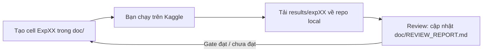

# doc/ — Quy trình thí nghiệm CCMC-SR trên Kaggle

Thư mục này chứa (1) nội dung cell Kaggle cho **từng** thí nghiệm, tạo **trước** khi chạy và (2) báo cáo review sau khi có kết quả.

Kế hoạch gốc: [paper/README_CCMC_SR_v2_3_oracle_leakage_reviewed.md](../paper/README_CCMC_SR_v2_3_oracle_leakage_reviewed.md). Mục tiêu là **cải tiến một toán tử bên trong MiT-B0** (K/V Spatial Reduction), không ghép thêm model.

## Vòng lặp làm việc

1. Trước mỗi thí nghiệm có một file `doc/NN_<tên>.md`, gồm các cell copy-paste theo thứ tự.
2. Bạn chạy trên Kaggle, rồi tải `results/expNN/` (file zip ở cell cuối) về repo local, giải nén vào `results/expNN/`.
3. Bạn báo "đã có kết quả expNN". Tôi đọc file, review xem kết quả có bám mục tiêu/gate hay không và cập nhật [REVIEW_REPORT.md](REVIEW_REPORT.md).
4. Tôi chỉ tạo cell cho thí nghiệm tiếp theo khi đã biết kết quả gate trước đó (G1 → G2 → G3 → G4).

## Danh sách thí nghiệm

| Exp | File | Sprint / Plan ID | Nội dung | Gate | Trạng thái |
|---|---|---|---|---|---|
| 00 | [00_setup_kaggle.md](00_setup_kaggle.md) | — | Clone, cài đặt, kiểm tra API HF, unit test | Test phải pass | Sẵn sàng |
| 01 | [01_baseline_diagnostics.md](01_baseline_diagnostics.md) | D1–D2 / P0–P1, N0–N1 | Bin kích thước, L0 2 seeds, LiteSent seed 0, Diag-D0, Diag-D2 probe, profile | G1 | Sẵn sàng chạy |
| 02 | (tạo sau review Exp01) | D3 / P3a | C2, C3, C3-K5 (oracle, GT leakage) | G2-screen | Chưa tạo |
| 03 | (tạo sau review Exp02) | D4 / P3b | L2, L3 + oracle intervention 2×2 | G3 (H2: L3 − L2) | Chưa tạo |
| 04 | (tạo sau review Exp03) | D5 / P4 | K5, K6 cùng prior/budget | G4 | Chưa tạo |
| 05 | (tạo sau review Exp04) | D6 / P4–P5 | K1, K2, K3 + seed 2 | G4 | Chưa tạo |
| 06 | (tạo sau review Exp05) | D7 / P5 | Khóa cấu hình, test **một lần** | — | Chưa tạo |

## Ánh xạ cấu hình → cờ dòng lệnh (`src/train.py --ccmc=True`)

| ID | `--prior_mode` | `--injection` | `--prior_perturb` | Ghi chú |
|---|---|---|---|---|
| L0 | `none` | — | — | Baseline MiT-B0 5 băng + fusion, **không LLR** |
| L1 | `ndvi` | `ccmc_sr` | `none` | Prior NDVI cố định |
| L2 | `learned_veg` | `ccmc_sr` | `none` | Aux loss Crop ∪ Weed |
| **L3** | `learned_weed` | `ccmc_sr` | `none` | **Phương pháp đề xuất** |
| K1 | `learned_weed` | `none` | `none` | Head + aux, không nối vào SR |
| K2 | `learned_weed` | `ccmc_sr` | `window_shuffle` | Hoán vị prior trong cửa sổ SR |
| K2b | `learned_weed` | `ccmc_sr` | `global_shuffle` | Placebo hoán vị toàn ảnh |
| K3 | `learned_free` | `ccmc_sr` | `none` | Head không aux loss |
| K5 | `learned_weed` | `pre_sr_gate` | `none` | Gate trước SR, chuẩn hóa toàn ảnh, **không** chuẩn hóa cửa sổ |
| K6 | `learned_weed` | `post_sr_gate` | `none` | Gate trên token K/V **sau** LayerNorm của SR, trước phép chiếu key/value |
| C2 | `gt_veg` | `ccmc_sr` | `none` | Oracle GT (rò rỉ nhãn), chỉ sàng lọc |
| C3 | `gt_weed` | `ccmc_sr` | `none` | Oracle GT (rò rỉ nhãn), chỉ sàng lọc |
| C3-K5 / C3-K6 | `gt_weed` | `pre_sr_gate` / `post_sr_gate` | `none` | Đối chứng leakage |
| LiteSent | (`--ccmc=False --segformer=True --use_low_level_refine=True`) | | | Tham chiếu cũ, chạy lại trong cùng pipeline |

Siêu tham số chung (giữ nguyên cho mọi mô hình): Adam lr 3e-4, batch 8, 100 epoch, CE (0.9/1.0/1.3) × 0.7 + SoftDice × 0.3, augmentation xoay/lật/nhiễu, chọn checkpoint theo val mIoU. CCMC: `eps=0.1`, `lam_init=0.05`, stage 2–3, aux BCE × 0.3 (soft occupancy tại 150×150).

## Mã nguồn liên quan

- Toán tử + mô hình: [src/nets/ccmc_sr.py](../src/nets/ccmc_sr.py)
- Train: [src/train.py](../src/train.py) (cờ `--ccmc`, `--prior_mode`, `--injection`, `--prior_perturb`, `--resume`)
- Đánh giá (IoU, Boundary IoU, Small-Weed Recall theo bin, theo ngày, chất lượng prior, oracle intervention): [src/evaluate_ccmc.py](../src/evaluate_ccmc.py), [src/ccmc_metrics.py](../src/ccmc_metrics.py)
- Bin kích thước: [src/scripts/make_instance_bins.py](../src/scripts/make_instance_bins.py)
- Paired cluster bootstrap + gate: [src/scripts/compare_runs.py](../src/scripts/compare_runs.py)
- Diag-D2 probe: [src/scripts/probe_sr.py](../src/scripts/probe_sr.py)
- FLOPs/latency: [src/scripts/profile_model.py](../src/scripts/profile_model.py)
- Gom kết quả: [src/scripts/collect_results.py](../src/scripts/collect_results.py)
- Unit test: [tests/test_ccmc_sr.py](../tests/test_ccmc_sr.py)

## Quy tắc bắt buộc (từ kế hoạch)

- Mọi quyết định và chọn siêu tham số chỉ dùng **validation**. `evaluate_ccmc.py --split=test` sẽ từ chối chạy nếu thiếu `--confirm_test_locked=True`.
- C2/C3 dùng GT của chính ảnh đánh giá, nên **không** phải bằng chứng H2 hay upper bound. Mọi output của chúng có cờ `GT_LEAKAGE: true`.
- Ghi trạng thái `DONE / PARTIAL / NOT RUN` cho từng mục; không chạy lại test để chọn mô hình.
- Mỗi lần chạy cần push đúng commit lên GitHub trước; `run_config.json` ghi lại `git_commit`, `split_hash` và phiên bản thư viện.
