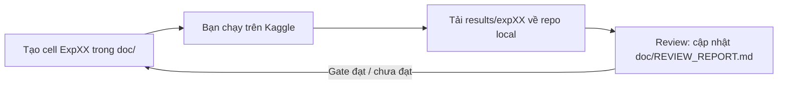

# doc/ — Quy trình thí nghiệm CCMC-SR trên Kaggle

Thư mục này chứa (1) nội dung cell Kaggle cho **từng** thí nghiệm, tạo **trước** khi chạy và (2) báo cáo review sau khi có kết quả.

Kế hoạch gốc: [paper/README_CCMC_SR_v2_3_oracle_leakage_reviewed.md](../paper/README_CCMC_SR_v2_3_oracle_leakage_reviewed.md). Mục tiêu là **cải tiến một toán tử bên trong MiT-B0** (K/V Spatial Reduction), không ghép thêm model.

## Vòng lặp làm việc

1. Trước mỗi thí nghiệm có một file `doc/NN_<tên>.md`, gồm các cell copy-paste theo thứ tự.
2. Bạn chạy trên Kaggle, rồi tải `results/expNN/` (file zip ở cell cuối) về repo local, giải nén vào `results/expNN/`.
3. Bạn báo "đã có kết quả expNN". Tôi đọc file, review xem kết quả có bám mục tiêu/gate hay không và cập nhật [REVIEW_REPORT.md](REVIEW_REPORT.md).
4. Tôi chỉ tạo cell cho thí nghiệm tiếp theo khi đã biết kết quả gate trước đó (G1 → G2 → G3 → G4).

## Danh sách thí nghiệm

| Exp | File                                                           | Sprint / Plan ID            | Nội dung                                                                                            | Gate                                           | Trạng thái                                                                                                         |
| --- | -------------------------------------------------------------- | --------------------------- | --------------------------------------------------------------------------------------------------- | ---------------------------------------------- | ------------------------------------------------------------------------------------------------------------------ |
| 00  | [00_setup_kaggle.md](00_setup_kaggle.md)                       | —                           | Clone, cài đặt, kiểm tra API HF, unit test                                                          | Test phải pass                                 | Sẵn sàng                                                                                                           |
| 01  | [01_baseline_diagnostics.md](01_baseline_diagnostics.md)       | D1–D2 / P0–P1, N0–N1        | Bìn kích thước, L0 2 seeds, LiteSent seed 0, Diag-D0, Diag-D2 probe, profile                        | G1                                             | DONE — G1 PASS có điều kiện                                                                                        |
| 02  | [02_oracle_c2_c3.md](02_oracle_c2_c3.md)                       | D3 / P3a                    | C2, C3, C3-K5, C3-K6 × 2 seed (oracle, GT leakage) + L0 đánh giá lại                                | G2-screen                                      | DONE — vô hiệu (λ kẹt 0,05)                                                                                        |
| 03  | [03_oracle_active_lambda.md](03_oracle_active_lambda.md)       | D3 làm lại / P3a            | C3a, C2a, C3f, C3K5a × 3 seed + L0 s2, kiểm tra cơ chế hoạt động, A/A test                          | G2-screen                                      | DONE — CCMC-SR dừng theo quy tắc                                                                                   |
| 04  | [04_bottleneck_localization.md](04_bottleneck_localization.md) | Định vị nút thắt            | LiteSent s1–s2, decoder 1/2 không chi tiết, decoder 1/2 với F1 (3 seed)                             | Chọn hướng phương pháp mới                     | DONE — nút thắt là độ phân giải dự đoán                                                                            |
| 05  | [05_mcsd.md](05_mcsd.md)                                       | Phương pháp mới             | MCSD, PS (đối chứng), MCSD-g × 3 seed                                                               | H-MCSD, H-mech, H-eff                          | DONE — MCSD-g PASS (val, 3 seed)                                                                                   |
| 06  | [06_confirm_5seeds.md](06_confirm_5seeds.md)                   | Xác nhận                    | Seed 3–4, bảng 5 seed, ablation inference Sinkhorn                                                  | MCSD-g confirmation                            | DONE — PASS seed 3–4; 5-seed Small-Weed Recall +7,84 pp [4,46; 11,66]                                              |
| 07  | [07_mechanism_audit.md](07_mechanism_audit.md)                 | Kiểm toán cơ chế            | OccCond-g 5 seed; marginal theo GT/predicted occupancy; precision, Crop→Weed, paired instance audit | Validation-only; không chọn cấu hình bằng test | DONE — OccCond-g recall/coverage cao hơn; MCSD-g marginal/precision/BIoU tốt hơn, không có mIoU gain rõ; xem mục 9 |
| 08  | [08_external_validation.md](08_external_validation.md) | WeedMap 003 + test lock | Inventory, class audit, 14 synthetic tests; audit commit fe3daf1 trên Kaggle | K8.2/K8.3: NO-GO cho tới khi mask/radiometry/evaluator được chấp thuận | IN PROGRESS — kiểm toán đã chạy; chưa mở test |

## Ánh xạ cấu hình → cờ dòng lệnh (`src/train.py --ccmc=True`)

| ID            | `--prior_mode`                                                | `--injection`                  | `--prior_perturb` | Ghi chú                                                                  |
| ------------- | ------------------------------------------------------------- | ------------------------------ | ----------------- | ------------------------------------------------------------------------ |
| L0            | `none`                                                        | —                              | —                 | Baseline MiT-B0 5 băng + fusion, **không LLR**                           |
| L1            | `ndvi`                                                        | `ccmc_sr`                      | `none`            | Prior NDVI cố định                                                       |
| L2            | `learned_veg`                                                 | `ccmc_sr`                      | `none`            | Aux loss Crop ∪ Weed                                                     |
| **L3**        | `learned_weed`                                                | `ccmc_sr`                      | `none`            | **Phương pháp đề xuất**                                                  |
| K1            | `learned_weed`                                                | `none`                         | `none`            | Head + aux, không nối vào SR                                             |
| K2            | `learned_weed`                                                | `ccmc_sr`                      | `window_shuffle`  | Hoán vị prior trong cửa sổ SR                                            |
| K2b           | `learned_weed`                                                | `ccmc_sr`                      | `global_shuffle`  | Placebo hoán vị toàn ảnh                                                 |
| K3            | `learned_free`                                                | `ccmc_sr`                      | `none`            | Head không aux loss                                                      |
| K5            | `learned_weed`                                                | `pre_sr_gate`                  | `none`            | Gate trước SR, chuẩn hóa toàn ảnh, **không** chuẩn hóa cửa sổ            |
| K6            | `learned_weed`                                                | `post_sr_gate`                 | `none`            | Gate trên token K/V **sau** LayerNorm của SR, trước phép chiếu key/value |
| C2            | `gt_veg`                                                      | `ccmc_sr`                      | `none`            | Oracle GT (rò rỉ nhãn), chỉ sàng lọc                                     |
| C3            | `gt_weed`                                                     | `ccmc_sr`                      | `none`            | Oracle GT (rò rỉ nhãn), chỉ sàng lọc                                     |
| C3-K5 / C3-K6 | `gt_weed`                                                     | `pre_sr_gate` / `post_sr_gate` | `none`            | Đối chứng leakage                                                        |
| LiteSent      | (`--ccmc=False --segformer=True --use_low_level_refine=True`) |                                |                   | Tham chiếu cũ, chạy lại trong cùng pipeline                              |

Siêu tham số chung (giữ nguyên cho mọi mô hình): Adam lr 3e-4, batch 8, 100 epoch, CE (0.9/1.0/1.3) × 0.7 + SoftDice × 0.3, augmentation xoay/lật/nhiễu, chọn checkpoint theo val mIoU. CCMC: `eps=0.1`, `lam_init=0.05`, stage 2–3, aux BCE × 0.3 (soft occupancy tại 150×150).

## Mã nguồn liên quan

- Toán tử + mô hình: [src/nets/ccmc_sr.py](../src/nets/ccmc_sr.py)
- Train: [src/train.py](../src/train.py) (cờ `--ccmc`, `--prior_mode`, `--injection`, `--prior_perturb`, `--resume`)
- Đánh giá (IoU, Boundary IoU, Small-Weed Recall theo bin, theo ngày, chất lượng prior, oracle intervention): [src/evaluate_ccmc.py](../src/evaluate_ccmc.py), [src/ccmc_metrics.py](../src/ccmc_metrics.py)
- Bin kích thước: [src/scripts/make_instance_bins.py](../src/scripts/make_instance_bins.py)
- Paired cluster bootstrap + gate: [src/scripts/compare_runs.py](../src/scripts/compare_runs.py)
- MCSD marginal audits and paired iteration/instance analysis: [src/scripts/mcsd_audit.py](../src/scripts/mcsd_audit.py), [src/scripts/mcsd_iteration_audit.py](../src/scripts/mcsd_iteration_audit.py)
- Diag-D2 probe: [src/scripts/probe_sr.py](../src/scripts/probe_sr.py)
- FLOPs/latency: [src/scripts/profile_model.py](../src/scripts/profile_model.py)
- Gom kết quả: [src/scripts/collect_results.py](../src/scripts/collect_results.py)
- Unit test: [tests/test_ccmc_sr.py](../tests/test_ccmc_sr.py)

## Quy tắc bắt buộc (từ kế hoạch)

- Mọi quyết định và chọn siêu tham số chỉ dùng **validation**. `evaluate_ccmc.py --split=test` sẽ từ chối chạy nếu thiếu `--confirm_test_locked=True`.
- C2/C3 dùng GT của chính ảnh đánh giá, nên **không** phải bằng chứng H2 hay upper bound. Mọi output của chúng có cờ `GT_LEAKAGE: true`.
- Ghi trạng thái `DONE / PARTIAL / NOT RUN` cho từng mục; không chạy lại test để chọn mô hình.
- Mỗi lần chạy cần push đúng commit lên GitHub trước; `run_config.json` ghi lại `git_commit`, `split_hash` và phiên bản thư viện.

## Exp08 — Chạy tiếp trên Kaggle sau commit fe3daf1 (2026-11-05)

Tài liệu chi tiết và code cell: [08_external_validation.md](08_external_validation.md) (bản cập nhật kèm theo). **Chỉ dùng Kaggle; không chạy local.** Các cell K8.0, K8.0d, K8.0e, K8.0f và K8.1 đã hoàn thành trước đó; không chạy lại nếu không có lý do kiểm toán.

1. Pull/clone mã tại commit `fe3daf1a91203b20d73aac960d08f2dbf96be872`. Chạy K8.0g xác minh HEAD và tồn tại/hashes của 15 checkpoint/config.
2. Chạy K8.0h để ghi bảng quan hệ mask/signal trên 204 frame (không đọc nhãn). Quan sát không thay thế tài liệu chính thức về mask polarity.
3. Chạy K8.0i để lưu PNG metadata và khoảng trống chứng cứ radiometry (không fit transform).
4. Chạy K8.0j, tải ZIP evidence về để review; **dừng trước K8.2/K8.3**.

**Đã xác minh từ paper:** Sa et al. (2018) Table 1 xác nhận RedEdge-M 003 là `test`, 94 effective tiles, GSD 0.99 cm/pixel: https://www.mdpi.com/2072-4292/10/9/1423. Archive có 204 tile slots; cần giải thích 94 vs 102 observed signal tiles. Không có Crop=1 trong 204 iMaps, không thể báo ba-lớp mIoU trên external test. PNG 8-bit khác 16-bit và mask polarity vẫn PENDING. Không giả mạo `GO` để vượt gate.
